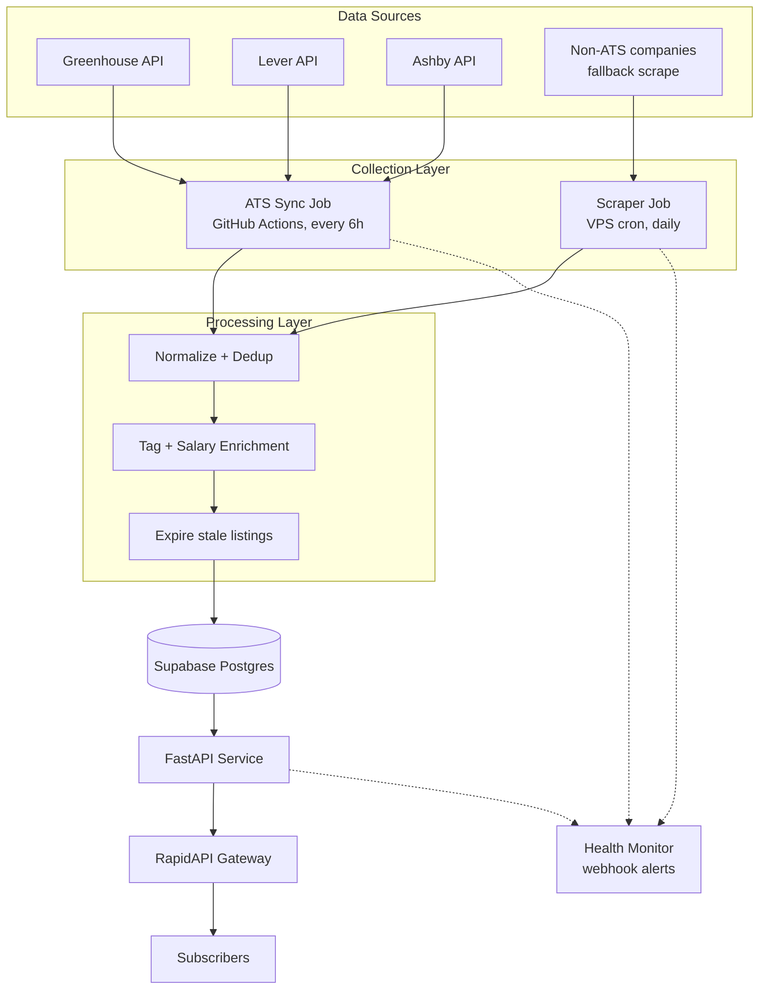
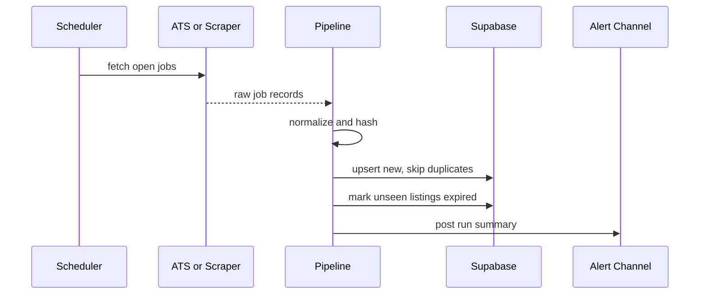

# JobRadar API — System Architecture

**Companion to:** PRD.md
**Last Updated:** August 1, 2026

---

## 1. Design Principles

Every choice below optimizes for one thing the original architecture didn't explicitly state: staying maintainable by one person, in spare time, indefinitely.

1. Prefer structured data sources (JSON APIs) over HTML scraping wherever one exists
2. Isolate fragile components so their failure can't cascade into the rest of the pipeline
3. Fail loud, not silent — every run reports its own health
4. Keep infra cost near $0 until there's revenue to justify more, then spend on reliability (backups, no cold starts) before spending on features
5. Every pipeline run is idempotent — safe to re-run after a partial failure, no manual cleanup

## 2. High-Level Architecture



## 3. Component Breakdown

### 3.1 Collection Layer

**ATS connectors (primary path)**

One small typed client per ATS, driven by a `sources.yaml` config:

```yaml
- company: "Example Startup"
  ats: greenhouse
  token: "examplestartup"
- company: "Another Startup"
  ats: lever
  token: "anotherstartup"
- company: "Newer Startup"
  ats: ashby
  token: "newerstartup"
```

Adding a company is a one-line config change — no new code, no new selectors to maintain.

| ATS | Endpoint pattern |
|---|---|
| Greenhouse | `GET https://boards-api.greenhouse.io/v1/boards/{token}/jobs` |
| Lever | `GET https://api.lever.co/v0/postings/{token}?mode=json` |
| Ashby | `GET https://api.ashbyhq.com/posting-api/job-board/{token}?includeCompensation=true` |

Each returns a different JSON shape (Greenhouse nests offices/departments, Lever flattens into categories, Ashby exposes a separate compensation object) — normalize all three into one internal schema at ingestion time.

Run cadence: every 6 hours. These are small JSON calls with no browser involved, so they're cheap enough to run often — this is also where most of the freshness advantage over a once-a-day competitor comes from.

**Fallback scraper (secondary path)**

Playwright/BeautifulSoup, scoped to a small, explicitly curated list of companies without an ATS API. Runs once daily on the VPS (not GitHub Actions — see §3.3). Each source tracks a consecutive-failure counter; after 3 failures it's auto-disabled and flagged rather than allowed to error the whole run silently.

### 3.2 Processing Layer

1. **Normalize** — lowercase/trim company, title, location before hashing
2. **Dedup** — `fingerprint_hash = SHA256(company|title|location)`, unique constraint on insert
3. **Enrich** — keyword-match tech tags; parse salary, preferring structured ATS fields (Ashby's compensation object) over regex on free text
4. **Expire** — any listing not seen in its source's latest run for N days flips to `status = expired`, keeping the database small and the data honest

### 3.3 Why GitHub Actions *and* a VPS, not just one

- ATS syncs are fast, lightweight JSON calls — a good fit for GitHub Actions. On a **public** repo, Actions minutes are unlimited; on a **private** repo, the free tier includes 2,000 Linux minutes/month, which comfortably covers four 6-hourly runs a day of pure API calls.
- The fallback scraper drives a real headless browser, which is heavier, slower, and more prone to timing out in an ephemeral CI container. Running it on the existing $5 VPS via cron avoids GitHub Actions' per-job limits and gives a stable, consistent environment for the one part of the pipeline that actually needs it.
- Net effect: the fragile part of the system runs in the environment best suited to it, and the reliable part runs on the free rail — neither has to compromise for the other.

### 3.4 API & Distribution Layer

- FastAPI app serving `/api/v1/jobs` and `/health`
- Hosted on a **paid** entry-level tier (Render Starter or Railway Hobby, roughly $7/mo) — not the free tier. Free web services on both platforms spin down after inactivity, with a 30-60 second cold start on the next request, which fails a sub-150ms latency target outright. This is one of the few line items in the whole project that isn't free, and it's not optional.
- RapidAPI handles discovery, billing, key management, and rate limiting per tier config. It remains the largest API marketplace by developer count, so it's a reasonable default — but keep the FastAPI app's own auth/rate-limit logic decoupled from RapidAPI-specific headers where possible, so a future move to self-hosted billing or a different marketplace doesn't mean rebuilding the API.

## 4. Data Flow (Single Run)



## 5. Monitoring & Observability

- **Run summaries** — every pipeline run posts a one-line summary (e.g. "1,402 active listings · 3 sources failed: acme, foo, bar") to a free webhook channel (Discord/Slack/email). You should never need to check logs manually to know the pipeline is healthy.
- **Uptime** — point a free external uptime monitor at `/health`. Any monitor that supports a basic HTTP check works.
- **Source health** — track consecutive failures per source; auto-disable + alert after 3, rather than let one broken source silently zero out part of your data or spam retries.

## 6. Security

- Secrets (DB credentials, webhook URLs) live in GitHub Actions secrets / hosting provider environment variables — never in the repo
- API auth via `X-RapidAPI-Proxy-Secret` or `X-API-Key`, validated server-side even though RapidAPI also gates access
- Rate limit at the app level too, not just at the RapidAPI gateway, so a key leak or gateway misconfiguration can't take the database down

## 7. Tech Stack Summary

| Layer | Choice | Why |
|---|---|---|
| Scraping (fallback only) | Python, Playwright + BeautifulSoup | Original choice, kept — just scoped down to a small curated list |
| ATS clients | Python, `httpx` | Plain JSON over HTTP, no browser needed |
| Database | Supabase (Postgres) | Managed, generous free tier, clear upgrade path to Pro |
| API | FastAPI | Original choice, kept |
| Scheduling | GitHub Actions (ATS) + VPS cron (scraper) | Matches each job type to the environment suited for it |
| Distribution/billing | RapidAPI | Original choice, kept, with an abstraction layer as insurance |

## 8. Scaling Path (Later, Not Now)

If this outgrows hobby infra:
- Supabase Pro → dedicated compute, daily backups, no auto-pause
- Add a cache (Redis) in front of hot queries (e.g., most recent listings by tag)
- Move billing off RapidAPI to capture the marketplace commission directly
- Expand ATS coverage (Workable, Recruitee, Personio, SmartRecruiters) if buyer demand supports it
